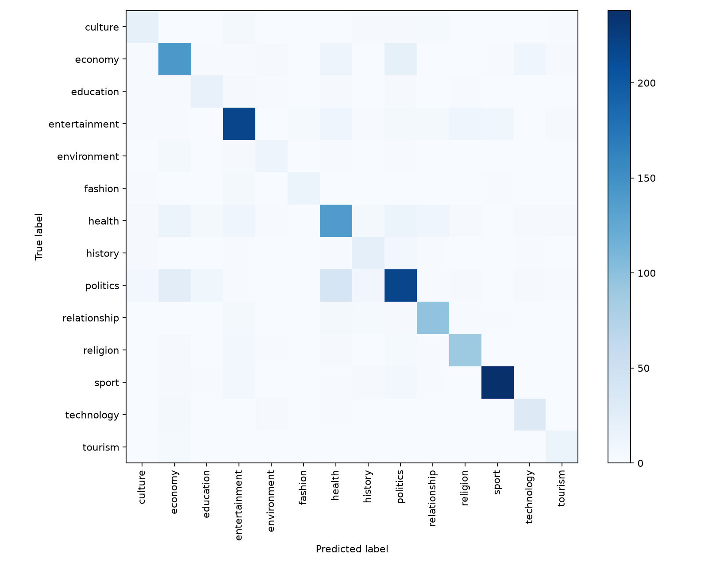

# KinyaNews AI
## Kinyarwanda News Topic Classification with TF-IDF and Linear Models

NLP Capstone — Text Classification for an African Language
Research results recorded: 18 October 2026

## Project links

GitHub Repository: https://github.com/alusamuel/KinyaNews-AI
Demo Video: https://canva.link/hhol2d33m4wq1ui
Live System: Public URL not supplied at report preparation; public accessibility is not independently verified in this report. The recorded demonstration and reproducible local application provide alternative evidence of interaction.

## 1. Abstract

This project investigates supervised topic classification for Kinyarwanda news and implements an interactive Flask application. The existing cleaned KINNEWS corpus provides 21,268 articles across 14 categories. Additional normalized-text deduplication and removal of contradictory text groups retain 10,924 articles, split into 7,646 training, 1,639 validation and 1,639 test records. A majority baseline is compared with word TF-IDF plus Logistic Regression, word TF-IDF plus Linear SVM, and character TF-IDF plus Linear SVM. The original comparison selects Logistic Regression using validation macro F1 of 0.71840. The selected model achieves 77.49% test accuracy and 0.72509 macro F1. Later validation-only ablations find that class weighting is beneficial and unigrams slightly exceed the original configuration; they do not alter the frozen deployment. Qualitative analysis identifies overlapping editorial topics, entity-driven lexical shortcuts and an English article in the nominal Kinyarwanda data. A lexical audit flags 51 test articles with training similarity of at least 0.90, limiting generalization claims despite zero exact overlap. The results support a practical lightweight prototype while showing that stronger data auditing and grouped evaluation should precede claims of broad reliability.

Keywords: Kinyarwanda; KINNEWS; topic classification; TF-IDF; Logistic Regression; reproducibility.

<!-- page -->
# 2. Introduction

Organizing news into topics supports article retrieval, editorial queues and archive indexing. For a Kinyarwanda collection, an automated classifier could reduce repetitive categorization work while leaving ambiguous decisions to a human reviewer. This project targets editors, archivists and readers as proposed users; it does not claim measured productivity gains or a completed user study.

Kinyarwanda is selected because the task is relevant to Rwanda's news context and there is an established labeled corpus suitable for reproducible research. Niyongabo et al. (2020) frame Kinyarwanda and Kirundi classification in terms of limited annotated resources and preprocessing challenges. The present task is classification, not machine translation; it does not claim that Kinyarwanda lacks existing translation systems.

The objective is to train, compare, evaluate and expose a 14-category classifier through a web interface. Four questions structure the investigation: whether learned lexical features outperform a majority baseline; whether word SVM or character features improve on word Logistic Regression; how weighting, n-grams and regularization affect validation macro F1; and what errors and data-quality checks reveal about the resulting estimates.

The contribution is an auditable implementation and empirical study using existing resources. It includes label-conversion checks, additional cleaning, a new split, controlled model comparisons, frozen-model evaluation, post-selection analysis and an inference application. It does not introduce a new classification algorithm or an independently collected corpus.

# 3. Related Work

Niyongabo et al. (2020) introduce KINNEWS and KIRNEWS, including monolingual and cross-lingual classification experiments and released data resources. Their work provides the direct task foundation. The accompanying research repository includes TF-IDF Logistic Regression and SVM alongside neural approaches (Niyongabo et al., n.d.). This makes lexical linear models a task-relevant starting point. Our pooled, deduplicated split differs from their benchmark protocol, so numerical scores cannot be used to rank this implementation against their published models.

Joulin et al. (2017) demonstrate that efficient text classification methods can remain competitive with deeper approaches on their evaluated tasks. This motivates taking lightweight models seriously, but does not imply that fastText and TF-IDF are equivalent or that their findings transfer automatically to this corpus. FastText is not implemented here.

Conneau et al. (2020) investigate multilingual Transformer representation learning and cross-lingual transfer. Such contextual approaches offer a direction for subsequent experiments, but require actual task-specific training and evaluation. The repository contains an optional Transformer training script, not a completed Transformer result.

Scikit-learn provides the fitted vectorizers, estimators and evaluation tools used in this implementation (Pedregosa et al., 2011). The focus of the study is transparent comparison and data validity, rather than assuming architectural complexity guarantees improvement. The implementation gap addressed is a reproducible local analysis connected to a working inference interface; it is not a claim that Kinyarwanda classification was previously unavailable.

<!-- page -->
# 4. Dataset and Data Preparation

## 4.1 Source, characteristics and label mapping

The project uses the existing cleaned KINNEWS corpus. The research repository describes collection from news websites and newspapers and documents 21,268 articles and 14 categories (Niyongabo et al., n.d.). A Hugging Face dataset card provides an additional distribution route (Niyongabo, n.d.). The exact archive URL, SHA-256 hashes and conversion procedure are recorded in data/source.json. The executed run imports the archived CSVs rather than relying on generated training records.

The source archive has one-based numeric labels; its raw files also contain English names. The importer verifies the numeric-to-name mapping, normalizes the source name “politic” to “politics”, and converts the cleaned CSV labels to English strings. The alternative Hugging Face loader uses zero-based IDs. These conventions must not be interchanged. Raw and cleaned row positions should not be assumed to identify the same article; source matching requires text or title verification.

## 4.2 Additional cleaning and split

Title and content are combined, Unicode-casefolded and whitespace-normalized. Texts shorter than 30 characters are excluded; the length check retains all 21,268 imported records in this run. Groups of identical normalized text carrying multiple labels are removed in full. The audit identifies 159 distinct conflicting texts; 1,453 removed rows belong to these groups, derived from the recorded totals. A further 8,891 duplicate rows are removed, leaving 10,924 unique records. Contradictory labels are removed rather than automatically reassigned.

A seed-42 stratified 70/15/15 split produces 7,646 training, 1,639 validation and 1,639 test articles. Normalized exact overlap is zero. Pooling original training and test files before deduplication deliberately creates a new evaluation protocol. Vocabulary and document-frequency estimation subsequently use training records only.

Table 1. Retained category counts before the new split.

| Category | Articles | Category | Articles |
| --- | ---: | --- | ---: |
| Politics | 2,082 | Technology | 253 |
| Entertainment | 1,769 | History | 229 |
| Sport | 1,718 | Culture | 215 |
| Health | 1,355 | Education | 186 |
| Economy | 1,283 | Environment | 138 |
| Relationship | 757 | Fashion | 129 |
| Religion | 701 | Tourism | 109 |

The largest category is approximately 19 times the smallest. The data is therefore unsuitable for judging model quality from accuracy alone. Source-disjoint splitting, systematic language verification and semantic deduplication are not part of preparation. Their implications are examined in Sections 7 and 9.

<!-- page -->
# 5. Methodology

## 5.1 Baseline and feature representations

The baseline is a most-frequent-class DummyClassifier. It predicts politics for every validation article and establishes whether the learned models improve over exploiting class prevalence. It is not presented as a practical final classifier.

Word models use TfidfVectorizer with ngram_range=(1,2), min_df=2, max_features=60,000 and sublinear_tf=True. Remaining vectorizer settings use the fitted library defaults. The effective pipeline uses sparse lexical features, rather than Word2Vec, GloVe or contextual embeddings. With smoothed inverse document frequency, a term's weight increases when it is relatively rare across training documents; sublinear term frequency reduces the influence of repeated occurrences. Vectors are L2-normalized (scikit-learn developers, n.d.-c).

The character comparator changes the analyzer to characters and uses 3–5 character n-grams while retaining the same minimum document frequency and feature ceiling. Character sequences can represent recurring fragments without explicit morphological analysis. The experiment tests their usefulness under this configuration, not the general superiority of one representation for the language.

## 5.2 Classifiers and training

The original word Logistic Regression uses balanced class weights, random_state=42 and max_iter=1,000; C=1 and the lbfgs solver follow the fitted defaults. It learns a linear score for each of 14 classes. Multinomial probabilities are obtained from the scores and the highest-probability class is selected. Regularization constrains coefficient growth; smaller C corresponds to stronger regularization (scikit-learn developers, n.d.-b). These probabilities are not separately calibrated in this study.

The word and character SVMs use LinearSVC with balanced class weights and random_state=42. They fit linear decision functions using the library's training implementation (scikit-learn developers, n.d.-a). All vectorizers and classifiers are fitted only on training data. A pipeline couples each fitted representation to its estimator, avoiding a separate test-fitted vocabulary. Scikit-learn supplies the algorithms; this project implements their data and experiment workflow (Pedregosa et al., 2011).

## 5.3 Selection, exploratory analysis and uncertainty

Original selection chooses the non-dummy candidate with the highest validation macro F1; validation accuracy breaks a tie. The selected pipeline is serialized as models/classifier.joblib. Test evaluation follows selection. Four later one-factor Logistic Regression ablations vary word n-grams, class weighting or C. Since they were conducted after inspection of the original test result, they remain exploratory validation analyses and do not replace or retest the frozen deployment.

Accuracy, precision, recall and F1 follow standard classification definitions (scikit-learn developers, n.d.-d). Precision is TP/(TP+FP), recall is TP/(TP+FN), and F1 is their harmonic mean. Macro F1 averages the 14 per-class F1 values equally. Weighted F1 weights by class support. The analysis also computes seeded, class-stratified bootstrap percentile intervals from 1,000 resamples. Paired resampling compares the two word-model validation predictions. These intervals condition on fixed fitted models and one split, not repeated-training or source uncertainty.

<!-- page -->
# 6. Experiments and Results

## 6.1 Original validation comparison

All original candidates use the same training and validation split. Table 2 reports the measured experiment outputs; elapsed fitting/evaluation times are specific to the local run and are not deployment latency benchmarks.

Table 2. Original validation experiments; selection uses macro F1.

| Model | Accuracy (%) | Macro F1 | Seconds |
| --- | ---: | ---: | ---: |
| Majority baseline | 19.04 | 0.02285 | 0.008 |
| Word TF-IDF + Logistic Regression | 79.38 | 0.71840 | 13.329 |
| Word TF-IDF + Linear SVM | 80.29 | 0.71710 | 8.596 |
| Character TF-IDF + Linear SVM | 79.38 | 0.70543 | 41.345 |

The learned methods substantially exceed the majority baseline. Word SVM provides the highest accuracy, while Logistic Regression narrowly leads macro F1. The 0.00130 macro-F1 difference is small; the paired bootstrap interval for Logistic Regression minus word SVM is [-0.02073, 0.02644], crossing zero. The selection rule yields a winner without establishing robust superiority. Character SVM is weaker under this feature budget and split, despite its potential to represent subword patterns.

## 6.2 Later validation-only ablations

Table 3 changes one factor from the original balanced word (1,2)-gram Logistic Regression with C=1. The original configuration is the reference, not a newly tuned test winner.

| Configuration | Accuracy (%) | Macro F1 |
| --- | ---: | ---: |
| Original reference | 79.38 | 0.71840 |
| Unigrams only | 79.07 | 0.71942 |
| Remove class weighting | 76.69 | 0.55462 |
| Stronger regularization: C=0.1 | 73.70 | 0.66774 |
| Weaker regularization: C=10 | 80.23 | 0.70728 |

Removing class weighting causes the largest macro-F1 reduction, supporting the balancing choice on this data. Stronger regularization reduces both measured metrics. Weaker regularization raises accuracy but reduces macro F1, illustrating that conclusions depend on the objective. Unigrams alone slightly exceed the reference, so bigrams are not clearly beneficial here. All four fits finish below the 1,000-iteration cap (15–82 iterations). The small unigram gain is retained as an exploratory finding. Changing deployment after inspecting the test set would weaken the original evaluation claim; a fresh evaluation design is needed for follow-up selection.

<!-- page -->
# 6. Experiments and Results (continued)

## 6.3 Frozen-model held-out performance

The selected original Logistic Regression model achieves 0.7748627 test accuracy and 0.7250922 macro F1. Macro precision is 0.71435, macro recall 0.74172, and weighted F1 0.77620. There are 1,270 correct predictions and 369 errors among 1,639 articles. The class-stratified bootstrap 95% interval for test macro F1 is [0.68869, 0.75660]. It does not correct for article overlap, annotation uncertainty or changes in source distribution.

Table 4. Per-class test results, rounded to three decimals.

| Category | Precision | Recall | F1 | Support |
| --- | ---: | ---: | ---: | ---: |
| Culture | 0.588 | 0.625 | 0.606 | 32 |
| Economy | 0.714 | 0.740 | 0.726 | 192 |
| Education | 0.545 | 0.643 | 0.590 | 28 |
| Entertainment | 0.835 | 0.823 | 0.829 | 265 |
| Environment | 0.632 | 0.571 | 0.600 | 21 |
| Fashion | 0.824 | 0.700 | 0.757 | 20 |
| Health | 0.648 | 0.676 | 0.662 | 204 |
| History | 0.512 | 0.647 | 0.571 | 34 |
| Politics | 0.781 | 0.696 | 0.736 | 313 |
| Relationship | 0.821 | 0.850 | 0.835 | 113 |
| Religion | 0.840 | 0.848 | 0.844 | 105 |
| Sport | 0.952 | 0.926 | 0.939 | 257 |
| Technology | 0.674 | 0.816 | 0.738 | 38 |
| Tourism | 0.636 | 0.824 | 0.718 | 17 |

Sport is strongest by F1, while history and education are weaker. Low minority-class support makes estimates sensitive to relatively few decisions. The gap between weighted and macro F1 is consistent with uneven category performance. Class frequency alone cannot explain every error: topic overlap and label quality also matter.

Training articles have median length 1,779 characters. Descriptive test accuracy is 0.76667 for 210 texts below 1,000 characters, 0.76844 for 1,166 texts at 1,000–2,999, and 0.80769 for 260 texts at 3,000–10,000. These groups do not establish a causal length effect. Three longer test articles are correctly predicted offline but exceed the application's input limit; deployment coverage and offline evaluation are therefore not identical.

<!-- page -->
# 6. Experiments and Results: Confusion Matrix

Figure 1. Confusion matrix of the selected Logistic Regression model on the 1,639-article test set. Rows indicate supplied labels and columns indicate predictions; darker cells represent larger raw counts. The diagonal contains correct predictions. Category supports differ, so raw cell intensity should be interpreted alongside Table 4 rather than as a class-normalized comparison.

The largest off-diagonal group is politics predicted as health (40 articles), followed by politics as economy (25), economy as politics (20), health as economy (14), and health as politics (14). These patterns motivate examining article content rather than treating each mismatch as a purely technical optimizer failure. Full confusion counts and local article-level predictions are retained in the research artifacts.

<!-- page -->
# 7. Error Analysis and Discussion

## 7.1 Representative successes and failures

Examples below use zero-based positions in data/test.csv. They were selected for interpretation, not sampled to estimate error prevalence. Full local text is paired with an identifier in results/explained_examples.json; long article passages are not reproduced here.

A successful entertainment example (row 1) describes a Miss Rwanda contestant. Positive contributions from “miss”, “nyampinga” and “miss rwanda” support the correct prediction. This illustrates useful domain-specific vocabulary, while not establishing semantic understanding.

An environment-to-economy error (row 4) concerns tree-planting workers awaiting payment. The environmental activity supports the supplied label, while payment and contractor terms favor economy. The strongest positive economic terms include “amafaranga” and “rwiyemezamirimo”. A single-label formulation compresses a story with multiple plausible topics.

An entertainment-to-relationship error (row 9) describes a celebrity discussing partner preferences. Romance vocabulary, including “urukundo” and “gukundana”, favors relationship. The supplied entertainment label reflects celebrity framing. This boundary is consistent with the broader difficulty of using lexical topic cues without explicit editorial context.

In row 0, the supplied economy label conflicts with a health prediction for an article discussing doctors, patients and treatment. Health-related vocabulary supports the model output. This suggests editorial ambiguity or possible annotation error, but no independent adjudication was performed and the label was not corrected. In row 2, mentions of the president contribute toward politics for an economy-labeled conservation article, illustrating possible entity shortcuts.

Row 10 is an English article about forest-related compensation despite the nominal Kinyarwanda setting. It is predicted as entertainment rather than its supplied environment label. “The” is its largest positive entertainment contribution, indicating a language-quality mismatch and a potentially spurious lexical cue. The observed English example does not quantify the corpus-wide rate of language contamination.

Contributions are calculated as a feature value multiplied by its coefficient for the predicted class. They explain part of the linear score; intercepts and competing class scores also matter. These are model explanations, not causal proof or calibrated correctness probabilities.

## 7.2 Relation to the research context

The existence of task-relevant lexical and neural baselines in the KINNEWS research resources supports comparison with simple models before adding complexity (Niyongabo et al., n.d.). The present analysis shows that high-level topic categories can be useful while still leaving disagreements driven by mixed content and source labeling. The practical value of efficient classification suggested by Joulin et al. (2017) should therefore be considered alongside evaluation validity. A faster or larger model does not resolve ambiguous gold labels or related articles crossing splits.

<!-- page -->
# 8. Deployment

## 8.1 Inference workflow

The interface accepts a Kinyarwanda passage and posts JSON to /api/predict. Flask checks that text is a string and contains 30–10,000 characters after whitespace normalization. It loads models/classifier.joblib through a cached loader, predicts a category, and returns English and Kinyarwanda display names together with the top three Logistic Regression probabilities. The interface labels those probabilities as uncalibrated model scores. The app does not retrain on user requests or depend on a chatbot API.

GET /health reports whether the model is loaded. Missing artifacts produce HTTP 503 rather than fabricated predictions. Invalid prediction inputs produce HTTP 400 when the model is available. Static JavaScript displays the category and handles request failures. The source and saved artifact are separated so research data is not required in production.

## 8.2 Packaging and verification

The runtime uses Python 3.13 with pinned packages, including scikit-learn 1.8.0. The deployment ZIP includes only the selected model, metadata, inference source, templates, static assets, runtime requirements and Vercel configuration. Research CSVs, the notebook, full per-article outputs and unused candidates are excluded from the deployment bundle. The function exclusion setting was shortened to comply with the reported 256-character configuration limit; remaining exclusions are in .vercelignore.

Local verification passed 17 tests, checked model/data hashes, confirmed exact split disjointness and compared API predictions with direct inference for 14 held-out category examples. A separate clean runtime installed the pinned wheels, passed dependency checks, reproduced held-out accuracy and macro F1, and passed extracted-package homepage, static asset, health and prediction checks. These results establish local reproducibility of the tested workflow, not a cloud availability or scalability guarantee.

## 8.3 Access and alternative demonstration

The source repository and submitted demonstration link are provided at the start of this report. The Canva link was supplied by the project owner; its permissions and video contents were not independently verified in preparing this report. No public Vercel URL was supplied, so public uptime and inference cannot be asserted from the available evidence. For reproducible alternative interaction, install requirements.txt, retain models/classifier.joblib and models/metadata.json, run python app.py, and visit http://localhost:5000. Research reproduction additionally requires the corpus and training dependencies.

The live-system URL should be included once supplied and verified. This is an evidence limitation rather than a claim that hosting is impossible. The recorded demonstration remains separately subject to reviewer access and assessment of the presenter's understanding.

## 8.4 Reproduction map

Data import and cleaning: src/import_corpus.py and src/prepare_data.py. Original experiments: src/train_baseline.py. Held-out evaluation: src/evaluate.py. Later ablations, uncertainty and overlap screen: src/analyze_results.py. Inference: app.py. Package construction: src/package_deployment.py. The executed notebook records the original end-to-end workflow, and docs/LOCAL_HANDOFF.md describes setup and commands.

<!-- page -->
# 9. Limitations and Future Work

A training-neighbor audit uses the frozen word TF-IDF space and cosine similarity. It flags 36 validation and 51 test articles at similarity at least 0.90; 22 validation and 42 test articles exceed 0.95. Maximum similarities are 0.99794 and 0.99918. These findings indicate residual lexical overlap after exact deduplication, potentially from rewrites or templates. They are not confirmed semantic duplicate counts. Reviewing the pairs and grouping related articles before a fresh split is a higher priority than reporting more digits of accuracy.

Only one random article split and one original training configuration per candidate were used. Bootstrap intervals condition on that split and do not account for source distribution, temporal drift, repeated training or annotation uncertainty. The late ablations are explicitly exploratory. A future study should preregister its selection procedure and use grouped cross-validation or a fresh held-out collection.

Corpus labels were not independently adjudicated, and the English example shows that language purity should be audited. Systematic language screening, source recovery and multi-annotator review could clarify whether apparent model errors reflect topic ambiguity or inconsistent annotation. These tasks require care before automatically deleting records or relabeling test examples.

The classifier always chooses one of 14 topics for accepted inputs. It has no verified out-of-domain rejection, probability calibration, multi-label support or fairness evaluation. A user study and assessment on current articles are absent. No latency, throughput or public uptime benchmark is claimed. Local operational checks do not establish suitability for consequential publication decisions.

Subsequent modeling could compare fastText or multilingual contextual representations with the lexical baselines, following the research directions of Joulin et al. (2017) and Conneau et al. (2020). Such experiments should follow data auditing, use measured validation results and preserve an untouched final evaluation. The optional Transformer script alone is not experimental evidence.

<!-- page -->
# 10. Conclusion

KinyaNews demonstrates a reproducible supervised classification workflow and a practical interface for Kinyarwanda news. On the new deduplicated split, the original word TF-IDF Logistic Regression candidate achieves 77.49% accuracy and 0.72509 macro F1. Its advantage over word SVM on validation macro F1 is narrow, while later ablations show a substantial benefit from class weighting and no clear advantage from adding bigrams under the tested settings.

The main lesson is that model comparison must be interpreted alongside data quality. Mixed editorial topics, a language-mismatched example and highly similar articles across splits restrict strong generalization claims. Transparent selection chronology, reproducible artifacts and representative failures provide a more useful account than presenting the score alone. The next research step is a stronger audited evaluation; the next practical step is verified public access and user-centered assessment.

## Resource and assistance acknowledgment

KINNEWS and the cited algorithms are existing resources. This project implements their preparation, experiment, evaluation and inference workflow. AI assistance was used for parts of the code, tests, analysis scripts and report drafting. Reported quantitative outputs come from executed workflows, not invented results; qualitative interpretations remain reviewable hypotheses. Automated checks do not substitute for the submitter's independent understanding or defense.

<!-- page -->
# 11. References

Conneau, A., Khandelwal, K., Goyal, N., Chaudhary, V., Wenzek, G., Guzmán, F., Grave, E., Ott, M., Zettlemoyer, L., & Stoyanov, V. (2020). Unsupervised cross-lingual representation learning at scale. Proceedings of ACL, 8440–8451. https://doi.org/10.18653/v1/2020.acl-main.747

Joulin, A., Grave, E., Bojanowski, P., & Mikolov, T. (2017). Bag of tricks for efficient text classification. Proceedings of EACL, Volume 2: Short Papers, 427–431. https://aclanthology.org/E17-2068/

Niyongabo, R. A. (n.d.). kinnews_kirnews [Dataset distribution]. Hugging Face. Retrieved October 18, 2026, from https://huggingface.co/datasets/andreniyongabo/kinnews_kirnews

Niyongabo, R. A., Hong, Q., Kreutzer, J., & Huang, L. (2020). KINNEWS and KIRNEWS: Benchmarking cross-lingual text classification for Kinyarwanda and Kirundi. Proceedings of COLING, 5507–5521. https://doi.org/10.18653/v1/2020.coling-main.480

Niyongabo, R. A., Hong, Q., Kreutzer, J., & Huang, L. (n.d.). KINNEWS-and-KIRNEWS-Corpus [Research repository]. Retrieved October 18, 2026, from https://github.com/Andrews2017/KINNEWS-and-KIRNEWS-Corpus

Pedregosa, F., Varoquaux, G., Gramfort, A., Michel, V., Thirion, B., Grisel, O., Blondel, M., Prettenhofer, P., Weiss, R., Dubourg, V., Vanderplas, J., Passos, A., Cournapeau, D., Brucher, M., Perrot, M., & Duchesnay, É. (2011). Scikit-learn: Machine learning in Python. Journal of Machine Learning Research, 12, 2825–2830. https://jmlr.org/papers/v12/pedregosa11a.html

scikit-learn developers. (n.d.-a). LinearSVC [API documentation]. Retrieved October 18, 2026, from https://scikit-learn.org/stable/modules/generated/sklearn.svm.LinearSVC.html

scikit-learn developers. (n.d.-b). LogisticRegression [API documentation]. Retrieved October 18, 2026, from https://scikit-learn.org/stable/modules/generated/sklearn.linear_model.LogisticRegression.html

scikit-learn developers. (n.d.-c). TfidfVectorizer [API documentation]. Retrieved October 18, 2026, from https://scikit-learn.org/stable/modules/generated/sklearn.feature_extraction.text.TfidfVectorizer.html

scikit-learn developers. (n.d.-d). Metrics and scoring: Quantifying the quality of predictions [Documentation]. Retrieved October 18, 2026, from https://scikit-learn.org/stable/modules/model_evaluation.html

## Research artifacts supporting this report

Counts and provenance: data/audit.json; data/source.json. Original comparisons: results/validation_experiments.csv. Exploratory comparisons: results/validation_ablations.csv. Test results: results/test_metrics.json; results/classification_report.csv; results/confusion_matrix.png. Interpretation and uncertainty: results/error_confusions.csv; results/explained_examples.json; results/quality_analysis.json; results/lexical_overlap.csv; results/uncertainty.json. Operational verification: results/model_verification.json; results/readiness.json; results/deployment_verification.json.
